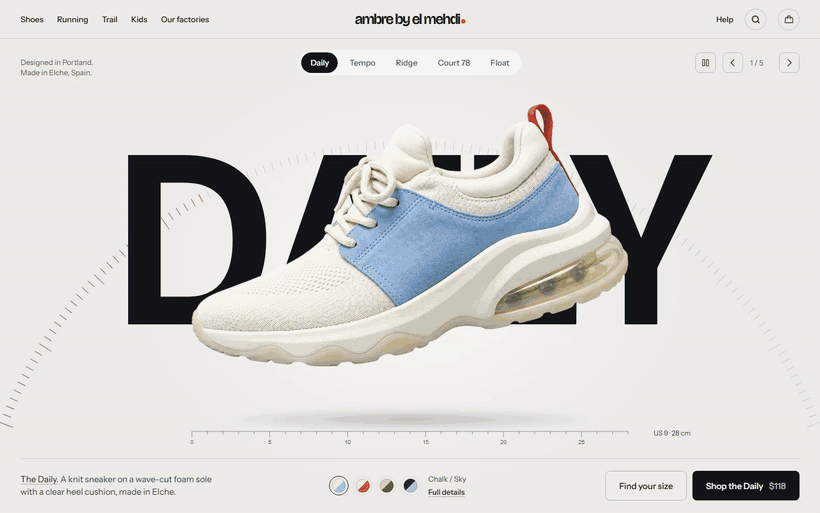
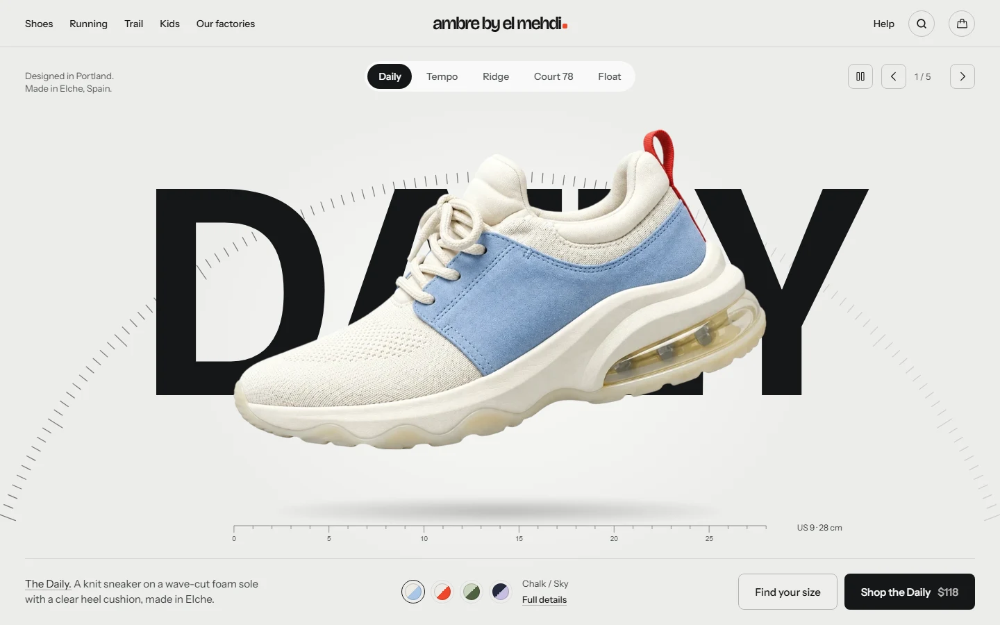
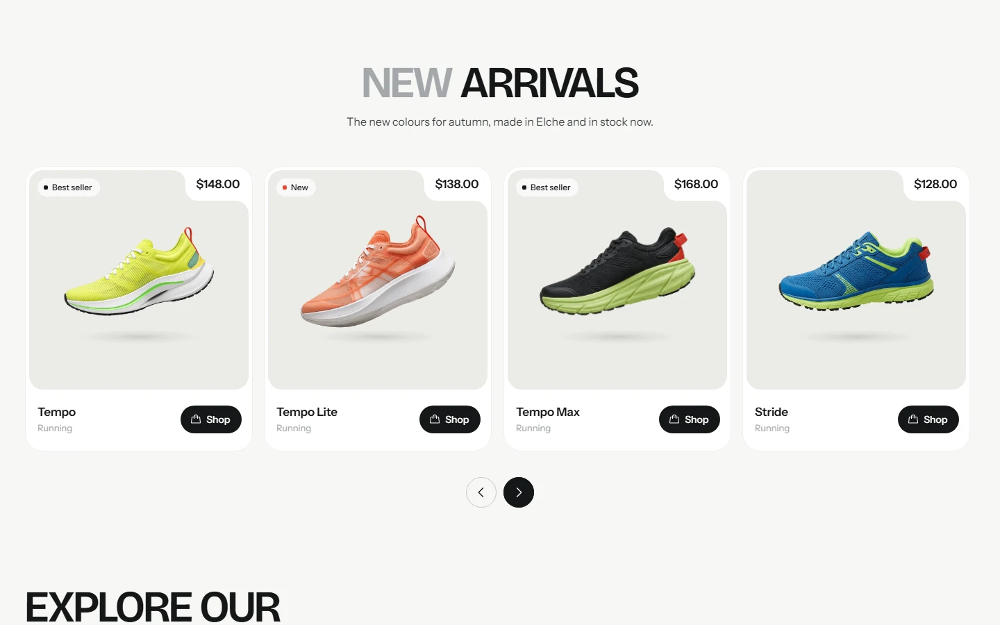
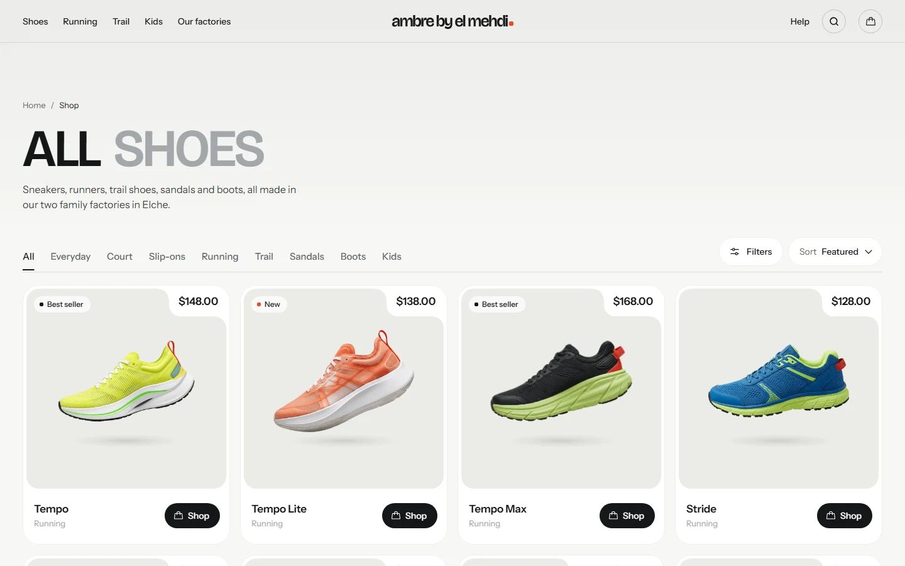
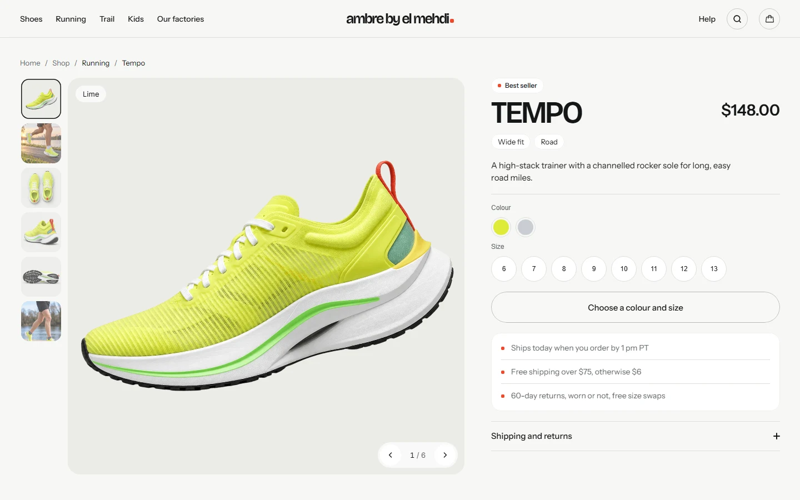
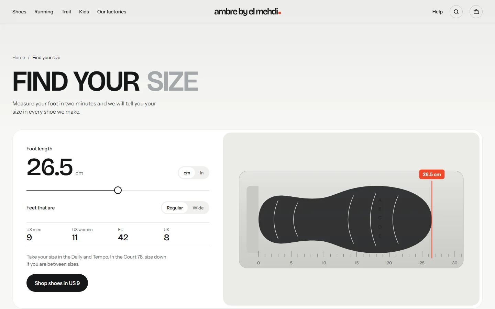
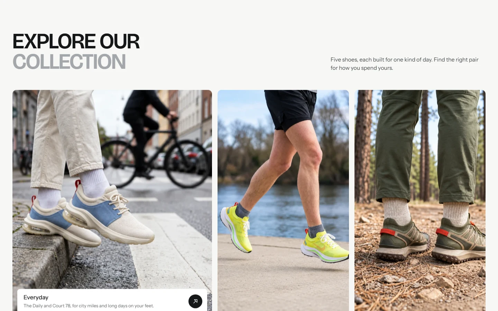
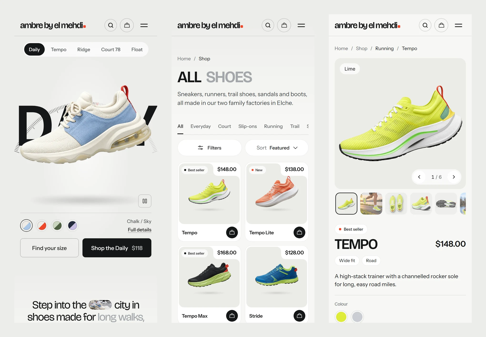

<div align="center">

# ambre By El Mehdi<sup>●</sup>

### Everyday sneakers, runners and trail shoes

A complete footwear storefront: animated product hero, shop with filters, 25 product pages,
cart, size finder and help centre. Fully responsive, statically built, deployed on Netlify.

[](https://ambre-ecom-store.netlify.app/)


<br>

<a href="https://ambre-ecom-store.netlify.app/"></a>

</div>

<br>

## ✦ Highlights

- **Animated product hero**: five models (Daily, Tempo, Ridge, Court 78, Float) with giant type, a size ruler, colour swatches, autoplay and prev/next controls.
- **Shop with filters**: 8 categories (Everyday, Court, Slip-ons, Running, Trail, Sandals, Boots, Kids), filter panel, sorting and an empty state.
- **25 product pages**: image gallery with thumbnails, colour and size variants, shipping info, "Made to wear" details and related products.
- **Cart, prices and currencies** through the Shopify Storefront API.
- **Size finder**: drag a slider to your foot length and get US / EU / UK sizes for every model.
- **Help centre, factories, privacy and terms** pages.
- **Scroll and hover animations** across the site.
- **Fast static build**: every page is pre-rendered, all images and fonts are served from the site itself, and nothing is indexed by search engines (test deploy).

<br>

## ✦ Screenshots

<table>
  <tr>
    <td width="50%"><p align="center"><b>Home</b>: product hero</p></td>
    <td width="50%"><p align="center"><b>New arrivals</b></p></td>
  </tr>
  <tr>
    <td><p align="center"><b>Shop</b>: categories, filters, sorting</p></td>
    <td><p align="center"><b>Product</b>: gallery, colours, sizes</p></td>
  </tr>
  <tr>
    <td><p align="center"><b>Size finder</b></p></td>
    <td><p align="center"><b>Collection</b></p></td>
  </tr>
</table>

### On phone

<p align="center"></p>

<br>

## ✦ Pages

| Route | Page |
|---|---|
| `/` | Home: hero, new arrivals, collection, best sellers, factories |
| `/shop` · `/shop/<category>` | Shop, filtered by category |
| `/shoes/<model>` | Product page (25 models) |
| `/fit` | Size finder |
| `/factories` | Where the shoes are made |
| `/help` | Help centre: shipping, returns, care, contact |
| `/privacy` · `/terms` | Legal |

<br>

## ✦ Stack

| | |
|---|---|
| **Site & CMS** | Framer (pages, components, animations, CMS collections) |
| **Commerce** | Framer Commerce + Shopify Storefront API (products, prices, currencies, cart) |
| **Build** | `scripts/build.mjs`: Node script that turns the site into static files for any host |
| **Hosting** | Netlify (auto-deploy on every push to `main`) |

<br>

## ✦ Getting started

```bash
git clone https://github.com/elmehdi-sekrare/whispered-petals-serenade.git ambre
cd ambre
npm start          # builds dist/ and serves it on http://localhost:5300
```

Node 22+. No packages to install.

| Command | What it does |
|---|---|
| `npm run build` | builds the static site into `dist/` |
| `npm start` | build + local preview on port 5300 |

### Change the content
Brand name, email, phone and links live in [`scripts/content.mjs`](scripts/content.mjs). Edit `ME` and rebuild.

<br>

## ✦ Deploy

1. Netlify → **Add new site → Import an existing project → GitHub** → pick this repo.
2. Settings come from [`netlify.toml`](netlify.toml): build `node scripts/build.mjs`, publish `dist`.
3. **Deploy.** Every push to `main` redeploys.

<br>

## ✦ Project structure

```
.
├── site/
│   ├── pages/          pre-rendered HTML for every route
│   ├── x/              scripts, styles, fonts, images and data used by the pages
│   └── index.json      index of the files in site/x/
├── scripts/
│   ├── build.mjs       static build → dist/
│   ├── content.mjs     brand name, contact details, links
│   └── serve.mjs       local preview server
├── docs/               README images
└── netlify.toml        Netlify build settings
```

<br>

## ✦ Contact

**El Mehdi Sekrare**: web developer, Mohammedia, Morocco

[](https://www.linkedin.com/in/el-mehdi-sekrare-77000629b)
[](mailto:elmehdisekrare@gmail.com)
[](https://github.com/elmehdi-sekrare)
